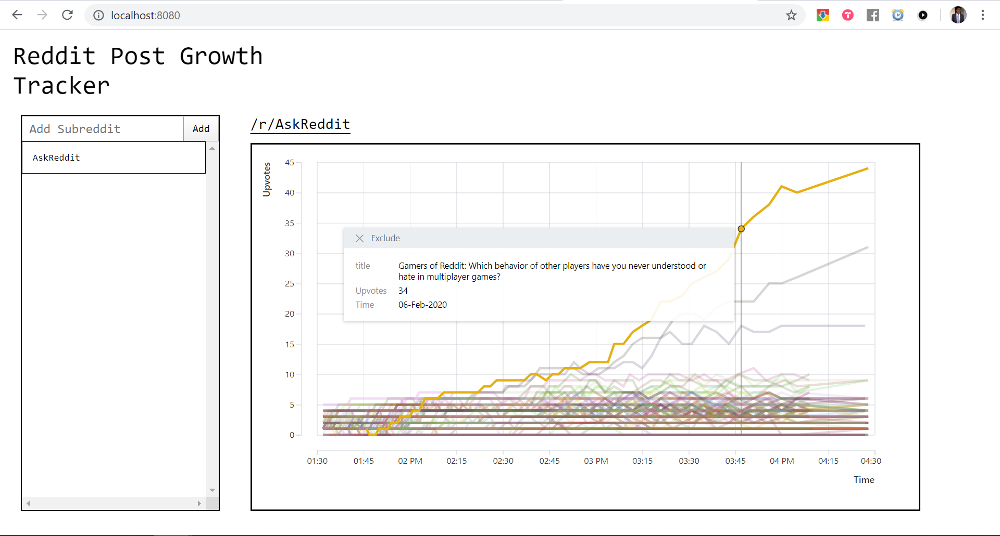

# Reddit Post Growth Tracker

A modern web application that tracks how Reddit posts grow over time, featuring a clean architecture with separated concerns and improved maintainability.



## 🚀 Features

- **Real-time Tracking**: Monitor Reddit post growth with automatic data collection
- **Interactive Dashboard**: Visualize post statistics with interactive graphs
- **Subreddit Management**: Subscribe to and manage multiple subreddits
- **Modern Architecture**: Clean separation of concerns with proper MVC structure
- **RESTful API**: Well-organized API endpoints for frontend integration
- **Error Handling**: Comprehensive error handling and user feedback

## 📁 Project Structure

```
reddit-post-growth-tracker/
├── backend/                    # Backend application
│   ├── config/                # Configuration management
│   │   ├── __init__.py
│   │   └── settings.py         # App configuration and settings
│   ├── database/              # Database layer
│   │   ├── __init__.py
│   │   └── manager.py         # Database connection and query utilities
│   ├── models/                # Data models
│   │   └── __init__.py       # Subreddit, Submission, SubmissionRecord models
│   ├── routes/               # API routes
│   │   ├── __init__.py
│   │   ├── analytics_routes.py # Analytics and data endpoints
│   │   └── subreddit_routes.py # Subreddit management endpoints
│   ├── services/              # Business logic
│   │   ├── __init__.py
│   │   ├── reddit_service.py  # Reddit API integration
│   │   └── analytics_service.py # Analytics and data processing
│   └── utils/                 # Utility functions
│       ├── __init__.py
│       └── database_init.py   # Database initialization utilities
├── src/                       # Frontend React application
│   ├── components/           # React components
│   │   ├── GraphWrapper/     # Data visualization component
│   │   ├── List/            # Subreddit list component
│   │   ├── SideBar/         # Sidebar navigation
│   │   └── SubscribeToSubredditForm/ # Subscription form
│   ├── App.js               # Main application component
│   ├── App.css              # Application styles
│   ├── index.js             # Application entry point
│   └── index.css            # Global styles
├── app.py                   # Main Flask application
├── init_db.py              # Database initialization script
├── tracker_service.py      # Background data collection service
├── config.json             # Reddit API configuration
└── README.md               # This file
```

## 🛠️ Installation & Setup

### Prerequisites

- Python 3.7+
- Node.js 12+
- Reddit API credentials

### **Easy Setup (Recommended)**

1. **Configure Reddit API credentials:**
   Create a `.env` file in the project root:
   ```bash
   REDDIT_CLIENT_ID=your_reddit_client_id
   REDDIT_CLIENT_SECRET=your_reddit_client_secret
   REDDIT_USER_AGENT=RedditPostGrowthTracker/1.0
   ```

2. **Start everything with one command:**
   ```bash
   ./start.sh --start-frontend
   ```

The `start.sh` script handles everything automatically:
- ✅ Detects and installs Python dependencies (pipenv or pip)
- ✅ Installs frontend dependencies (npm install)
- ✅ Initializes the database
- ✅ Starts the Flask backend server
- ✅ Starts the background data collection service
- ✅ Starts the frontend development server (with --start-frontend)

### **Manual Setup (Advanced)**

If you prefer to manage dependencies manually:

1. **Install Python dependencies:**
   
   **Option A: Using pipenv (recommended):**
   ```bash
   pipenv install
   ```
   
   **Option B: Using pip:**
   ```bash
   pip install flask flask-cors praw python-dotenv
   ```

2. **Initialize the database:**
   ```bash
   # Using pipenv
   pipenv run python init_db.py
   
   # Or using system python
   python3 init_db.py
   ```

3. **Start components separately:**
   ```bash
   # Backend server
   pipenv run python app.py  # or python3 app.py
   
   # Background service (in another terminal)
   pipenv run python tracker_service.py  # or python3 tracker_service.py
   
   # Frontend (in another terminal)
   npm start
   ```

## 🚀 Start Script Features

The `start.sh` script provides a one-command solution to get everything running:

### **Automatic Features:**
- **🔐 Credential Detection**: Automatically finds `.env` or `config.json` files
- **📦 Dependency Management**: Detects and uses pipenv if available, falls back to pip
- **🌐 Frontend Dependencies**: Automatically runs `npm install` if needed
- **🗄️ Database Setup**: Initializes database if it doesn't exist
- **🌐 Server Management**: Starts Flask backend and background service
- **🛑 Graceful Shutdown**: Handles Ctrl+C to stop all services cleanly

### **Usage:**
```bash
# Start backend only
./start.sh

# Start backend + frontend development server
./start.sh --start-frontend

# Build frontend for production + start backend
./start.sh --build-frontend

# Production mode (builds frontend)
./start.sh --frontend prod

# Show help
./start.sh --help
```

### **What it does:**
1. Checks for Reddit API credentials (`.env` or `config.json`)
2. Installs Python dependencies automatically
3. Initializes database if needed
4. Starts Flask server on port 5001
5. Starts background data collection service
6. Provides clear status messages and error handling

## 🛠️ Pipenv Scripts

The project includes convenient pipenv scripts for common tasks:

```bash
# Start the Flask server
pipenv run start

# Initialize the database
pipenv run init-db

# Run the background tracker service
pipenv run tracker

# Run tests
pipenv run test

# Run linting
pipenv run lint

# Format code
pipenv run format

# Type checking
pipenv run type-check
```

## 🔧 API Endpoints

### Subreddit Management
- `POST /api/subreddits/subscribe` - Subscribe to a subreddit
- `GET /api/subreddits/` - Get all subscribed subreddits

### Analytics
- `GET /api/analytics/submissions` - Get all submission data
- `GET /api/analytics/submissions/<limit>` - Get submission data with limit
- `POST /api/analytics/update-submissions` - Manually update submission data

### Health Check
- `GET /health` - API health status

## 🏗️ Architecture Improvements

### Backend Architecture

1. **Separation of Concerns**: Clear separation between models, services, and routes
2. **Database Layer**: Centralized database management with proper connection handling
3. **Service Layer**: Business logic encapsulated in service classes
4. **Configuration Management**: Centralized configuration with environment support
5. **Error Handling**: Comprehensive error handling throughout the application

### Frontend Improvements

1. **Component Organization**: Better component structure with clear responsibilities
2. **State Management**: Improved state handling with loading and error states
3. **User Experience**: Better feedback with loading indicators and error messages
4. **API Integration**: Clean API integration with proper error handling

## 🚀 Quick Start

### **Easy Setup (Recommended)**

1. **Configure Reddit API credentials:**
   Create a `.env` file in the project root:
   ```bash
   REDDIT_CLIENT_ID=your_reddit_client_id
   REDDIT_CLIENT_SECRET=your_reddit_client_secret
   REDDIT_USER_AGENT=RedditPostGrowthTracker/1.0
   ```

2. **Start everything with one command:**
   ```bash
   ./start.sh
   ```

3. **Start the frontend (in another terminal):**
   ```bash
   npm start
   ```

That's it! The `start.sh` script will automatically:
- ✅ Install Python dependencies (using pipenv if available)
- ✅ Initialize the database
- ✅ Start the Flask backend server
- ✅ Start the background data collection service

### **Manual Setup (Advanced)**

If you prefer to run components separately:

1. **Start the application:**
   - Backend: `python3 app.py` (or `pipenv run python app.py`)
   - Frontend: `npm start`
   - Background service: `python3 tracker_service.py` (or `pipenv run python tracker_service.py`)

2. **Subscribe to subreddits:**
   - Use the subscription form in the sidebar
   - Enter subreddit names (e.g., "python", "javascript")

3. **View post growth:**
   - Select subreddits from the sidebar
   - View interactive graphs showing post statistics over time

## 🔄 Data Collection

The background service (`tracker_service.py`) runs continuously to:
- Register new submissions from subscribed subreddits
- Record current statistics (score, upvotes, downvotes) for tracked posts
- Maintain data freshness with 60-second intervals

## 📊 Database Schema

- **subscribed_subreddits**: Stores subscribed subreddit information
- **subscribed_submissions**: Tracks individual posts being monitored
- **submission_records**: Historical statistics for each tracked post

## 🛡️ Error Handling

The application includes comprehensive error handling:
- API validation and error responses
- Database error handling with rollback support
- Frontend error states with user-friendly messages
- Graceful service shutdown handling

## 🔮 Future Enhancements

- [ ] Add date-created to submission schema
- [ ] Implement data caching and memoization
- [ ] Add more visualization options
- [ ] Implement user authentication
- [ ] Add export functionality
- [ ] Mobile-responsive design improvements

## 📝 Development Notes

- The application follows MVC architecture principles
- Database interactions are centralized through the DatabaseManager
- Reddit API calls are handled through the RedditService
- Frontend components are modular and reusable
- Error handling is consistent across all layers

## 🤝 Contributing

1. Fork the repository
2. Create a feature branch
3. Make your changes
4. Test thoroughly
5. Submit a pull request

## 📄 License

This project is licensed under the MIT License.